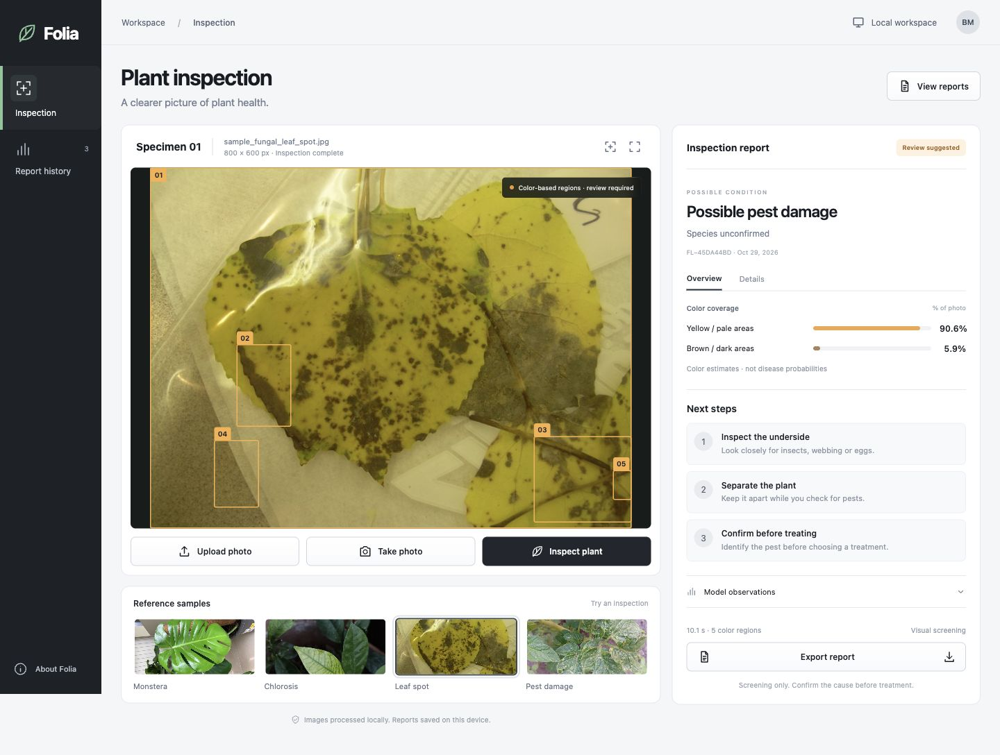

<div align="center">

# 🌿 Folia · Smart Plant Pathologist

**Capture · Inspect · Understand · Report**

A local plant inspection workspace with visual screening, image measurements and compact reports.


[🚀 Setup](#setup) · [▶️ Run](#run) · [✨ Capabilities](#capabilities) · [🧠 Model & measurements](#models) · [🛠️ Architecture](docs/architecture.md)

</div>



*The running application: specimen viewer and selectable color regions on the left; model-based screening, measured photo coverage and care actions on the right.*

> **Development preview:** Folia is a visual screening tool. Suggested conditions are not confirmed diagnoses. Region boxes mark color candidates, and the current model does not provide calibrated disease probabilities.

<a id="capabilities"></a>

## ✨ What it does

| Capability | Behavior |
|---|---|
| 📷 Photo capture | Upload a JPEG, PNG or WebP, drop a photo onto the canvas, or capture one with your camera. |
| 🔎 Visual screening | Ask a local vision model to describe leaf appearance and infer a possible condition from its observations. |
| 🎯 Region overlays | Locate yellow/pale and brown/dark color components; toggle boxes or select a region from the detailed report. |
| 📊 Image measurements | Show measured color coverage as a percentage of the **entire photo**, including its background. |
| 📝 Compact reports | Review a possible condition, species when recognized, three next steps and expandable model observations. |
| 🗂️ Inspection history | Keep the latest 30 report summaries in this browser on this device. Photos are not saved in history. |
| 📄 Portable exports | Download a standalone HTML report, then print it or save it as a PDF from your browser. |
| 💻 Responsive workspace | Use a side-by-side viewer and report on desktop, or a stacked layout on smaller screens. |
| 🔒 Local processing | Process photos through your local FastAPI and Ollama services; no cloud vision API or API key is required. |

**One focused workflow.** Choose a photo, select **Inspect plant**, review its image measurements and observations, then export a small report. Four botanical reference photos are included for trying the workflow. Their sample labels **do not override** the model's output in the web app.

<a id="setup"></a>

## 🚀 Get started

### 1 · Prepare Python and the vision model

Install **Python 3.10 or newer** and **[Ollama](https://ollama.com/)**. Download the default vision model:

```bash
ollama pull moondream
```

If Ollama is not already running, keep this command running in a separate terminal:

```bash
ollama serve
```

### 2 · Clone and install

```bash
git clone https://github.com/BrunoMelicio/smart-plant-pathologist.git
cd smart-plant-pathologist
python3 -m venv .venv
.venv/bin/python -m pip install -r requirements.txt
```

Use this **one environment** for the app and its tests. The commands below select its Python executable explicitly, so activation is optional.

### 3 · Check the installation

```bash
ollama list
.venv/bin/python -m unittest -v test_inspection
```

Confirm that `moondream` appears in the model list. The automated tests check image measurements, screening behavior and API validation with mocked inference; they do **not** verify the Ollama connection or open your camera.

<a id="run"></a>

## ▶️ Inspect a plant

```bash
.venv/bin/python -m uvicorn app:app --reload --host 127.0.0.1 --port 8801
```

Open **[http://localhost:8801](http://localhost:8801)**. Keep this terminal running; press **Ctrl+C** to stop the app.

1. Select **Upload photo**, **Take photo**, or one of the four reference samples.
2. Select **Inspect plant** and wait for the local model.
3. Review the report. Use **Details** for dimensions, model information and region measurements; expand **Model observations** to see the original description.
4. Select **Export report** to download a standalone HTML file. Open it and select **Print / Save as PDF** for a printable copy.

### 🎛️ Workspace controls

| Control | Use |
|---|---|
| **Upload photo** | Choose a supported image, up to 15 MB and 25 megapixels. |
| **Take photo** | Open a desktop camera preview or the native capture picker on supported mobile devices. |
| **Region toggle** | Show or hide candidate color boxes without changing the report. |
| **Expand image** | Open the specimen canvas full screen when the browser supports it. |
| **Overview / Details** | Switch between a concise summary and measurement/method details. |
| **View reports** | Browse saved summaries and export a previous report. |

Camera capture requires browser permission and a secure context, such as **localhost or HTTPS**. The default server address is accessible only on the machine running it. Camera behavior depends on the browser and device; photo upload is also available.

### ⚙️ Configuration

| Environment variable | Default | Use |
|---|---|---|
| `OLLAMA_BASE_URL` | `http://127.0.0.1:11434` | Address of your Ollama server. |
| `OLLAMA_VISION_MODEL` | `moondream` | Installed Ollama vision model to query. |

For example, set both explicitly when starting the server:

```bash
OLLAMA_BASE_URL=http://127.0.0.1:11434 OLLAMA_VISION_MODEL=moondream \
  .venv/bin/python -m uvicorn app:app --reload --host 127.0.0.1 --port 8801
```

Configuration is read from the process environment. The app does **not** automatically load a `.env` file.

<a id="models"></a>

## 🧠 Model and image measurements

| Component | Implementation | Role |
|---|---|---|
| Vision | **Moondream 1.8B**, served through Ollama | Describe visible plant appearance; identify a species when recognizable. |
| Screening | Python rules applied to the model's description | Suggest a possible health category; request further review when evidence is insufficient. |
| Color coverage | Pillow HSV thresholds | Measure yellow/pale and brown/dark pixels in a resized copy of the photo. |
| Candidate regions | Connected-component extraction | Show up to five of the largest qualifying color regions. |
| Reports | Browser-local storage and standalone HTML | Save summaries and export compact, printable reports. |

The model receives a JPEG copy resized to fit within **1024 × 1024 pixels**. Color analysis uses a separate copy with a longest edge of at most **256 pixels**. Neither operation overwrites the uploaded photo.

### 📊 Validation and practical limits

- **Five automated tests** cover known color coverage and bounding-box coordinates, absence of color candidates, negated symptoms, insufficient model evidence and API input/response behavior.
- Browser checks exercised reference and uploaded-photo inspections against the local model, report tabs, overlay controls, history and HTML export.
- Desktop and mobile layouts were checked, including a **390 px** mobile viewport without horizontal overflow.
- The current development environment uses **Python 3.12** and a local Ollama installation. Camera hardware capture and fresh-machine installation still need validation.
- Inference speed depends on model loading, hardware and image content. The Ollama request timeout is **110 seconds**; there is no guaranteed subsecond response time.

**Coverage is not probability.** Percentages describe color pixels across the whole photograph, including background. They do not measure the probability of a disease or the proportion of diseased leaf tissue. Boxes are color candidates, **not a trained lesion detector or leaf segmentation**. Shadows, lighting, backgrounds and natural pigmentation can all affect them.

Model observations can be incomplete or incorrect. Screening rules can confuse similar visual patterns; a photo alone cannot establish a pathogen, nutrient deficiency or pest species. Confirm the cause before treatment.

## 🔒 Privacy and storage

Photos are sent to the configured Python/Ollama services. With the default localhost configuration, processing stays on your machine. Configuring a remote Ollama server sends the photo to that server.

The browser stores the latest **30 report summaries** in local storage. Uploaded photos are not included in that history. Exported reports contain observations and measurements, without embedding the photo. The interface uses no third-party fonts, script CDNs or CSS CDNs.

## 🧪 Run the tests

```bash
.venv/bin/python -m unittest -v test_inspection
```

These tests use synthetic images and mocked model responses. They do not open a camera, download model weights or run inference.

The original live-model smoke test remains available:

```bash
.venv/bin/python sample_test.py
```

That legacy script calls Ollama. Its preset cases intentionally return fixed reference diagnoses; they do **not** establish model accuracy. The web workspace always uses the unhinted inspection path.

## 🛠️ Project structure

```text
smart-plant-pathologist/
├── app.py                    # FastAPI routes and upload validation
├── pathologist_engine.py     # Local vision requests and screening rules
├── inspection.py             # Color measurements and candidate regions
├── schemas.py                # Structured screening result
├── test_inspection.py        # Offline regression tests
├── sample_test.py            # Legacy live-model smoke test
├── requirements.txt          # Python dependencies
├── static/
│   ├── index.html            # Inspection workspace
│   ├── workspace.css         # Responsive design system
│   ├── workspace.js          # Capture, reports, history and export
│   └── samples/              # Four botanical reference photographs
├── docs/
│   └── architecture.md       # Processing and report flow
└── design/                   # Design reference, notes and app screenshot
```
