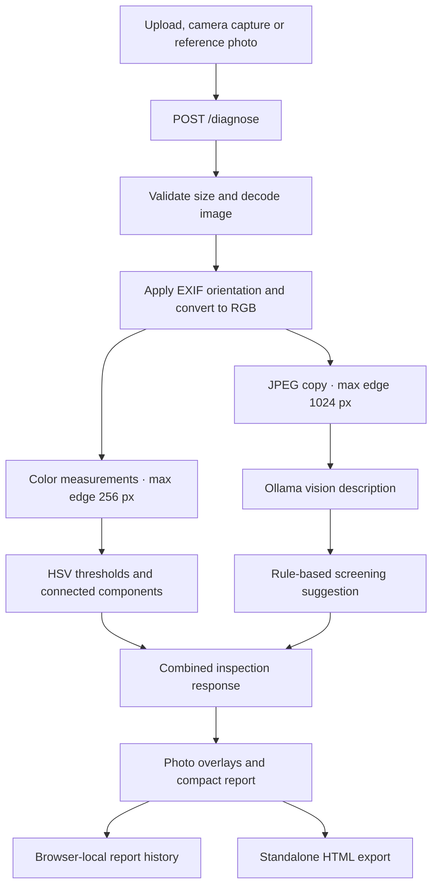

# 🛠️ Architecture and processing flow

Folia is a single FastAPI application serving a static browser interface. Ollama supplies local vision inference; Pillow supplies deterministic color measurements. No frontend build step or database service is required.

## 🔄 Inspection flow

## 📷 Input and validation

`app.py` accepts a multipart `image` upload or one of four `sample_key` values: `healthy`, `chlorosis`, `fungal` and `pest`. Uploaded images take priority when both fields are present.

Uploads are limited to **15 MB** and **25 megapixels**. Images smaller than 32 pixels on either side are rejected. Pillow decodes the file, applies EXIF orientation and converts it to RGB. Reference labels select a photograph; they never force the workspace's screening result.

The browser's desktop camera preview captures a JPEG through a canvas, then uses the same upload path. Supported mobile devices use a native capture picker. Camera streams stop when the preview closes or the page exits.

## 🎯 Color measurements and regions

`inspection.py` works on a copy of the image with a maximum edge of 256 pixels:

1. Convert RGB pixels to HSV.
2. Apply separate yellow/pale and brown/dark color thresholds.
3. Divide matching pixel counts by the **entire resized photo area**.
4. Extract connected components using four-neighbor connectivity.
5. Filter out very small components and return up to five of the largest regions.

Coordinates are normalized to the image dimensions, allowing the browser to place boxes over the displayed photo at different viewport sizes. Region coverage and category coverage use the full photo as their denominator. Color categories can overlap; their percentages are not a probability distribution.

This is color analysis, not leaf segmentation or a trained disease detector. Background objects, shadows and natural pigmentation can produce candidates.

## 🧠 Model observations and screening

`pathologist_engine.py` sends a JPEG copy, resized to fit within 1024 × 1024 pixels, to Ollama's `/api/generate` endpoint. The default model is `moondream`, the request uses non-streaming output, and the timeout is 110 seconds.

The returned text is mapped to broad screening suggestions through keyword rules. Explicitly negated symptom phrases are removed before symptom matching. Sparse descriptions without enough recognizable health evidence produce an **Undetermined** result.

The API combines this result with measured image coverage, candidate regions, dimensions, model name, elapsed time and an inspection ID. `probability` is `null`: the current model does not return calibrated disease probabilities.

The original engine retains a legacy preset path for `sample_test.py`. The web endpoint always passes `None` for that preset argument, so reference photos receive unhinted inference.

## 🗂️ Browser state and reports

`static/workspace.js` manages file selection, camera capture, inference progress, region overlays, report tabs and exports. Model-generated text is escaped or inserted as text rather than executed as HTML.

After a successful inspection, the latest 30 reports are stored under `folia-reports` in this browser's local storage. Stored reports include model observations and image measurements, but no uploaded image bytes. History supports reviewing summaries and exporting previous reports; it does not restore the original photograph.

Export creates a standalone HTML document containing the inspection summary, color measurements, next steps, model observations and method notes. Its **Print / Save as PDF** control opens the browser's print dialog. The export does not embed the specimen photo.

## 📡 Endpoints

| Route | Purpose |
|---|---|
| `GET /` | Serve the workspace. |
| `GET /health` | Report web service status, configured model and Ollama URL. This does not probe model availability. |
| `POST /diagnose` | Validate a photo, perform measurements, query the model and return an inspection. |
| `GET /static/...` | Serve local scripts, styles and reference photographs. |
| `GET /docs` | FastAPI's interactive API documentation. |

## 🧪 Verification

Run `test_inspection.py` for offline regression tests. It covers synthetic color coverage and coordinates, empty candidate results, negation handling, insufficient evidence and API validation/response behavior with mocked inference. Live model behavior, camera hardware and deployment conditions need separate validation.
